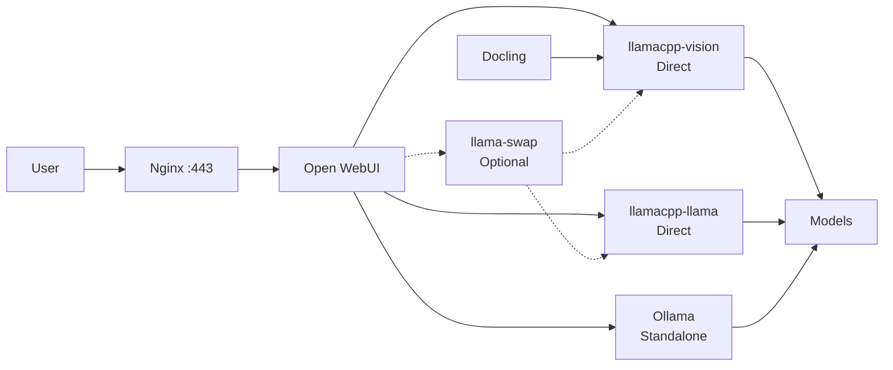
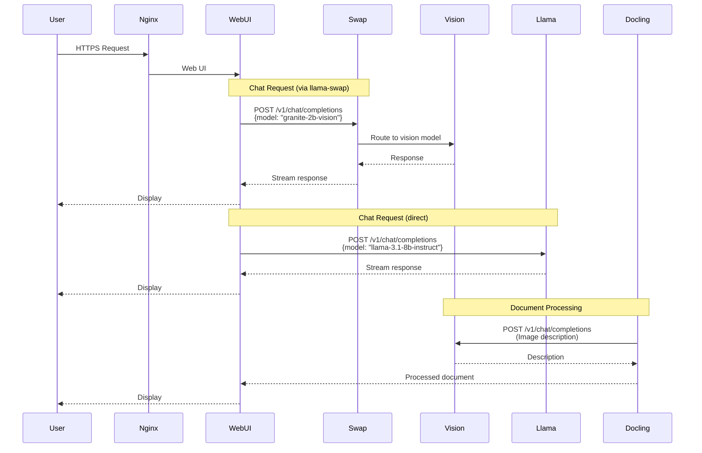

# Spark Deploy

A production-ready Docker Compose deployment for running multiple LLM models on NVIDIA ARM64 hardware (DGX Spark/GB10). This setup provides a complete AI inference stack with document processing, vision capabilities, and automatic model routing.

## Project Location

Clone this repository to your desired location:

It provides a clean, containerized deployment for:
- **Open WebUI** - Web interface for interacting with LLMs
- **Docling** - Document processing with vision model integration
- **content-extraction** - Optional sidecar for fast, manufacturing-optimized document extraction (Word, PDF, spreadsheets) with per-type routing; see `content-extraction/README.md`
- **llama.cpp** - Multiple model inference servers (vision and text)
- **llama-swap** - Automatic model routing and switching
- **Nginx** - Reverse proxy and load balancing

## Architecture

### System Overview



### Request Flow



## Used Repositories

This project integrates and builds upon the following open-source projects:

### Core Components

- **[Open WebUI](https://github.com/open-webui/open-webui)** - Extensible, feature-rich, and user-friendly self-hosted WebUI
  - Image: `ghcr.io/open-webui/open-webui:main`
  - Connects to standalone Ollama via `OLLAMA_BASE_URL=http://ollama:11434`
  - License: Apache 2.0

- **[Ollama](https://github.com/ollama/ollama)** - Run LLMs locally (standalone container; models in `open-webui-ollama` volume)
  - Image: `ollama/ollama:latest`
  - License: MIT

- **[Docling](https://github.com/DS4SD/docling)** - Document processing framework with vision model integration
  - Image: `ghcr.io/docling-project/docling-serve-cu130:main`
  - License: Apache 2.0

- **[llama.cpp](https://github.com/ggerganov/llama.cpp)** - Inference engine for LLMs
  - Base: [ggerganov/llama.cpp](https://github.com/ggerganov/llama.cpp)
  - Docker Image: `cslev/llamacpp-cuda-arm64:latest` (from [cslev/llamacpp-cuda-arm64-docker](https://github.com/cslev/llamacpp-cuda-arm64-docker))
  - License: MIT

- **[llama-swap](https://github.com/mostlygeek/llama-swap)** - Transparent proxy for OpenAI/Anthropic compatible servers
  - Source: [mostlygeek/llama-swap](https://github.com/mostlygeek/llama-swap)
  - License: MIT

- **[Nginx](https://nginx.org/)** - High-performance web server and reverse proxy
  - Image: `nginx:alpine`
  - License: 2-clause BSD

### Docker Images

- **llamacpp-cuda-arm64**: Pre-built CUDA-enabled llama.cpp image for ARM64
  - Repository: [cslev/llamacpp-cuda-arm64-docker](https://github.com/cslev/llamacpp-cuda-arm64-docker)
  - Optimized for NVIDIA GB10/DGX Spark hardware

## Quick Start

### Prerequisites

- Docker & Docker Compose
- NVIDIA GPU with CUDA support (ARM64 architecture)
- NVIDIA Container Toolkit installed
- At least 16GB VRAM recommended for multiple models

### 1. Clone and Setup

```bash
# Clone the repository
git clone git@github.com:AlaiPartners/spark-deploy.git
cd spark-deploy

# Copy environment template
cp .env.example .env

# Edit .env with your paths (MODELS_DIR, etc.)
nano .env
```

### 2. Deploy

```bash
# Use deploy script (recommended)
./scripts/deploy.sh

# Option B: Manual deployment
docker compose up -d
```

The deploy script will:
- Download default models if needed
- Generate SSL certificates if missing
- Start all services

### 3. Setup SSL Certificates

The deploy script will automatically generate self-signed certificates if they don't exist. For production, see `nginx/ssl/README.md` for Let's Encrypt setup.

### 4. Access Services

- **Open WebUI**: https://localhost (via Nginx only; no direct port — Open WebUI runs with 2 replicas behind Nginx)
- **Docling UI**: http://localhost:5001
- **Ollama**: http://localhost:11434 (model API; warmup container preloads `gpt-oss-20b` after startup)
- **Nginx**: https://localhost (HTTPS) or http://localhost (redirects to HTTPS)

**Note**: For self-signed certificates, browsers will show a security warning. Click "Advanced" → "Proceed to localhost" to continue.

## Services

| Service | Port | Description | Status |
|---------|------|-------------|--------|
| **Open WebUI** | via Nginx | Web interface (2 replicas, load-balanced behind Nginx) | Active |
| **Ollama** | 11434 | Standalone LLM server; warmup preloads `gpt-oss-20b` | Active |
| **Docling** | 5001 | Document processing with vision (memory capped 16GB) | Active |
| **llamacpp-vision** | 8001 (internal) | Vision model (Granite 3.3-2B) | Active |
| **llamacpp-llama** | 8001 (internal) | Text model (Llama 3.1 8B) | Active |
| **llama-swap** | 8080 (internal) | Model routing proxy | Optional |
| **Nginx** | 80, 443 | Reverse proxy (HTTP→HTTPS redirect) | Active |

## Configuration

### Environment Variables

Key variables in `.env`:

```bash
# Model directories (use $HOME, not ~)
MODELS_DIR=$HOME/models

# Vision model paths
VISION_MODEL_PATH=/models/granite-vision-3.3-2b/granite-vision-3.3-2b-Q8_0.gguf
VISION_MM_PROJ_PATH=/models/granite-vision-3.3-2b/mmproj-model-f16.gguf

# Text model paths
LLAMA_MODEL_PATH=/models/llama-3.1-8b-instruct/Meta-Llama-3.1-8B-Instruct-Q4_K_M.gguf

# Optional: Custom llama.cpp or llama-swap paths
# LLAMA_CPP_PATH=/path/to/llama.cpp
# LLAMA_SWAP_PATH=/path/to/llama-swap
```

### Adding New Models

Use the interactive CLI tool:

```bash
# Activate virtual environment
source venv/bin/activate  # or run setup_venv.sh first

# Run the model addition tool
python3 add_model.py
```

The tool will:
- Guide you through model selection (HuggingFace or local)
- Download quantized models automatically
- Configure Docker Compose services
- Update llama-swap configuration

See [ADD_MODEL_README.md](./docs/ADD_MODEL_README.md) for detailed usage.

### Open WebUI Configuration

**Important**: When configuring connections in Open WebUI, use Docker service names directly (e.g., `http://llamacpp-vision:8001/v1`), not `localhost` or external URLs, as Open WebUI runs within the Docker network.

#### Option 1: Direct Connections (Recommended)

Add connections directly to llama.cpp instances:

1. **Vision Model**:
   - Name: `llama-vision`
   - URL: `http://llamacpp-vision:8001/v1`
   - API Key: (leave blank)
   - Note: Uses Docker service name `llamacpp-vision`

2. **Text Model**:
   - Name: `llama-text`
   - URL: `http://llamacpp-llama:8001/v1`
   - API Key: (leave blank)
   - Note: Uses Docker service name `llamacpp-llama`

#### Option 2: llama-swap Proxy (Optional)

Add one connection for automatic routing:

- Name: `llama-swap`
- URL: `http://llama-swap:8080/v1`
- API Key: (leave blank)
- Note: Uses Docker service name `llama-swap`

Both models will be automatically available and routed based on the `model` field in requests.

#### Option 3: Standalone Ollama

Ollama runs in its own container. In Open WebUI, add the connection:

- Name: `ollama`
- URL: `http://ollama:11434`
- API Key: (leave blank)

Models are stored in the `open-webui-ollama` volume (preserved from the previous open-webui:ollama setup). From the host you can run `ollama pull <model>` (port 11434 is published).

#### Docker Service Names Reference

When configuring connections in Open WebUI, use these Docker service names:
- `ollama:11434` - Standalone Ollama (models, local LLMs)
- `llamacpp-vision:8001` - Vision model service
- `llamacpp-llama:8001` - Text model service
- `llama-swap:8080` - Model routing proxy (if enabled)
- `docling:5001` - Document processing service

See [OPEN-WEBUI-CONFIG.md](./docs/OPEN-WEBUI-CONFIG.md) for detailed setup instructions.

### Docling Document Processing Configuration

To enable document processing and image description in Open WebUI using Docling:

1. Navigate to **Settings** -> **Features** -> **Document Processing**.
2. Set the **Engine** to `docling`.
3. Configure the **Docling API Parameters** with the following JSON. **Use Docker service names directly**:

```json
{
  "do_ocr": true,
  "ocr_engine": "easyocr",
  "ocr_lang": [
    "en"
  ],
  "pdf_backend": "dlparse_v4",
  "table_mode": "accurate",
  "include_images": true,
  "do_picture_description": true,
  "picture_description_api": "{\"url\": \"http://llamacpp-vision:8001/v1/chat/completions\", \"params\": {\"model\": \"granite-2b-vision\", \"max_tokens\": 8152}, \"timeout\": 60, \"prompt\": \"Your image description prompt here.\"}"
}
```

**Example Picture Description Prompt**:
```
You are analyzing a technical documentation page from an industrial automation system. For each image or diagram on the page, provide a structured description that includes: (1) the type of visual (flowchart, screenshot, annotated UI, diagram, etc.), (2) the key elements visible and their relationships or layout, (3) any text labels, callouts, or annotations present and what they point to, and (4) the functional purpose of the image in context of the surrounding documentation. Be precise and literal — avoid inference beyond what is visually present.
```

## Model Information

### Currently Configured Models

| Model | Type | Size | Quantization | Context Size | Use Case |
|-------|------|------|--------------|--------------|----------|
| **Granite Vision 3.3-2B** | Vision | ~1.3GB | Q8_0 | 32,768 | Image descriptions, document analysis |
| **Llama 3.1 8B Instruct** | Text | ~4.6GB | Q4_K_M | 16,384 | General chat, text generation |

### Adding More Models

The `add_model.py` tool supports:
- **HuggingFace downloads**: Automatic quantized model downloads
- **Local models**: Browse and select existing GGUF files
- **Vision models**: Automatic mmproj detection and configuration
- **Text models**: Flash attention and optimization flags

## Monitoring & Logs

### View Logs

```bash
# All services
docker compose logs -f

# Specific service
docker compose logs -f llamacpp-vision
docker compose logs -f llama-swap
docker compose logs -f nginx

# Nginx access/error logs
tail -f nginx/logs/access.log
tail -f nginx/logs/error.log
```

### Health Checks

```bash
# Check service status
docker compose ps

# Test llama.cpp servers
curl http://localhost:8001/health  # (if port mapped)
curl http://llamacpp-vision:8001/health  # (from within network)

# Test llama-swap
curl http://llama-swap:8080/health
```

## Troubleshooting

### CUDA Issues

If you see CUDA driver errors:

```bash
# Verify NVIDIA drivers
nvidia-smi

# Test Docker GPU access
docker run --rm --gpus all nvidia/cuda:12.0-base nvidia-smi
```

### Model Loading Failures

- Verify model paths in `.env` match actual file locations
- Check file permissions: models should be readable
- Ensure both `.gguf` and `.mmproj` files exist for vision models

### Port Conflicts

If ports are already in use:

```bash
# Check what's using the port
sudo lsof -i :80
sudo lsof -i :11434

# Modify ports in the relevant compose fragment if needed
```

### Nginx 502 Errors

- Check that upstream services are running: `docker compose ps`
- Verify Nginx can reach services: `docker compose exec nginx ping llamacpp-vision`
- Check Nginx error logs: `tail -f nginx/logs/error.log`

## Additional Documentation

- [compose/README.md](./compose/README.md) - Compose layout, domains, and external volumes
- [content-extraction/README.md](./content-extraction/README.md) - Manufacturing-optimized document extraction and Open WebUI setup
- [ADD_MODEL_README.md](./docs/ADD_MODEL_README.md) - Guide to adding new models
- [OPEN-WEBUI-CONFIG.md](./docs/OPEN-WEBUI-CONFIG.md) - Open WebUI connection setup
- [ROUTER_MODE_COMPARISON.md](./docs/ROUTER_MODE_COMPARISON.md) - Single router vs multi-container analysis

## Contributing

This is a deployment configuration project. Contributions welcome for:
- Additional model configurations
- Improved deployment scripts
- Documentation improvements
- Performance optimizations

## License

This project configuration is provided as-is. Individual components maintain their respective licenses:
- Open WebUI: Apache 2.0
- Docling: Apache 2.0
- llama.cpp: MIT
- llama-swap: MIT
- Nginx: 2-clause BSD

## Acknowledgments

- [ggerganov/llama.cpp](https://github.com/ggerganov/llama.cpp) - Core inference engine
- [cslev/llamacpp-cuda-arm64-docker](https://github.com/cslev/llamacpp-cuda-arm64-docker) - ARM64 CUDA Docker image
- [mostlygeek/llama-swap](https://github.com/mostlygeek/llama-swap) - Model routing proxy
- [open-webui/open-webui](https://github.com/open-webui/open-webui) - Web interface
- [DS4SD/docling](https://github.com/DS4SD/docling) - Document processing
