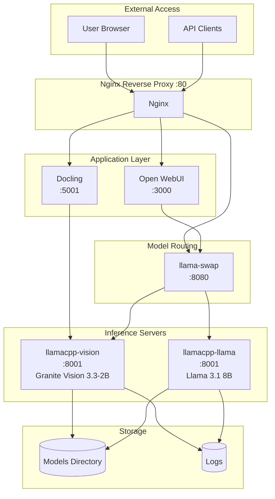
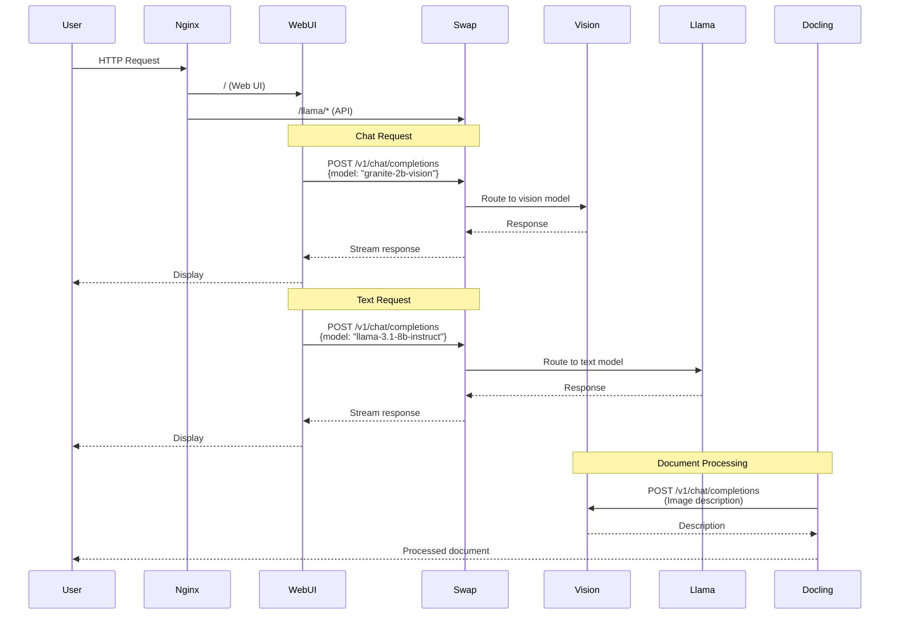
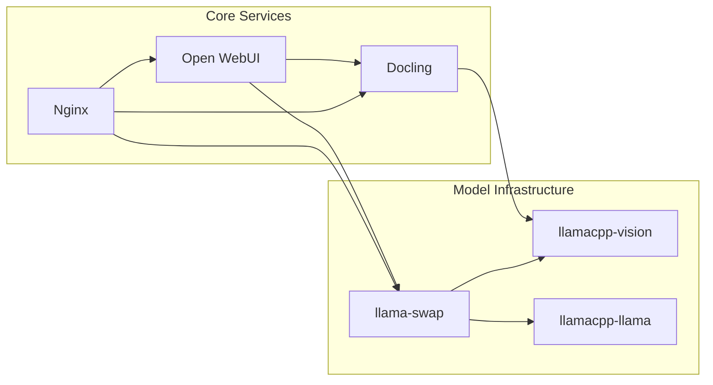

# Spark Deploy

A production-ready Docker Compose deployment for running multiple LLM models on NVIDIA ARM64 hardware (DGX Spark/GB10). This setup provides a complete AI inference stack with document processing, vision capabilities, and automatic model routing.

## 📍 Project Location

This project is located at: `/home/admin/spark-dev-workspace/spark-deploy`

It provides a clean, containerized deployment for:
- **Open WebUI** - Web interface for interacting with LLMs
- **Docling** - Document processing with vision model integration
- **llama.cpp** - Multiple model inference servers (vision and text)
- **llama-swap** - Automatic model routing and switching
- **Nginx** - Reverse proxy and load balancing

## 🏗️ Architecture

### System Overview



### Request Flow



### Service Dependencies



## 🔗 Used Repositories

This project integrates and builds upon the following open-source projects:

### Core Components

- **[Open WebUI](https://github.com/open-webui/open-webui)** - Extensible, feature-rich, and user-friendly self-hosted WebUI
  - Image: `ghcr.io/open-webui/open-webui:ollama`
  - License: Apache 2.0

- **[Docling](https://github.com/DS4SD/docling)** - Document processing framework with vision model integration
  - Image: `ghcr.io/docling-project/docling-serve-cu130:main`
  - License: Apache 2.0

- **[llama.cpp](https://github.com/ggerganov/llama.cpp)** - Inference engine for LLMs
  - Base: [ggerganov/llama.cpp](https://github.com/ggerganov/llama.cpp)
  - Docker Image: `cslev/llamacpp-cuda-arm64:latest` (from [cslev/llamacpp-cuda-arm64-docker](https://github.com/cslev/llamacpp-cuda-arm64-docker))
  - License: MIT

- **[llama-swap](https://github.com/mostlygeek/llama-swap)** - Transparent proxy for OpenAI/Anthropic compatible servers
  - Source: [mostlygeek/llama-swap](https://github.com/mostlygeek/llama-swap)
  - License: MIT

- **[Nginx](https://nginx.org/)** - High-performance web server and reverse proxy
  - Image: `nginx:alpine`
  - License: 2-clause BSD

### Docker Images

- **llamacpp-cuda-arm64**: Pre-built CUDA-enabled llama.cpp image for ARM64
  - Repository: [cslev/llamacpp-cuda-arm64-docker](https://github.com/cslev/llamacpp-cuda-arm64-docker)
  - Optimized for NVIDIA GB10/DGX Spark hardware

## 🚀 Quick Start

### Prerequisites

- Docker & Docker Compose
- NVIDIA GPU with CUDA support (ARM64 architecture)
- NVIDIA Container Toolkit installed
- At least 16GB VRAM recommended for multiple models

### 1. Clone and Setup

```bash
cd /home/admin/spark-dev-workspace/spark-deploy

# Copy environment template
cp .env.example .env

# Edit .env with your paths (MODELS_DIR, etc.)
nano .env
```

### 2. Deploy

```bash
# Option A: Use deploy script (recommended)
export LLAMA_CPP_PATH=/path/to/llama.cpp  # Optional, if building custom image
./scripts/deploy.sh

# Option B: Manual deployment
docker compose up -d
```

The deploy script will:
- Download default models if needed
- Build llama-swap if required
- Start all services

### 3. Access Services

- **Open WebUI**: http://localhost:3000 (or http://localhost via Nginx)
- **Docling UI**: http://localhost:5001
- **Nginx**: http://localhost (routes all traffic)

## 📦 Services

| Service | Port | Description | Status |
|---------|------|-------------|--------|
| **Open WebUI** | 3000 | Web interface for LLM interactions | ✅ Active |
| **Docling** | 5001 | Document processing with vision | ✅ Active |
| **llamacpp-vision** | 8001 (internal) | Vision model (Granite 3.3-2B) | ✅ Active |
| **llamacpp-llama** | 8001 (internal) | Text model (Llama 3.1 8B) | ✅ Active |
| **llama-swap** | 8080 (internal) | Model routing proxy | ⚠️ Optional |
| **Nginx** | 80 | Reverse proxy | ✅ Active |

## 🔧 Configuration

### Environment Variables

Key variables in `.env`:

```bash
# Model directories (use $HOME, not ~)
MODELS_DIR=$HOME/models

# Vision model paths
VISION_MODEL_PATH=/models/granite-vision-3.3-2b/granite-vision-3.3-2b-Q8_0.gguf
VISION_MM_PROJ_PATH=/models/granite-vision-3.3-2b/mmproj-model-f16.gguf

# Text model paths
LLAMA_MODEL_PATH=/models/llama-3.1-8b-instruct/Meta-Llama-3.1-8B-Instruct-Q4_K_M.gguf

# Optional: Custom llama.cpp or llama-swap paths
# LLAMA_CPP_PATH=/path/to/llama.cpp
# LLAMA_SWAP_PATH=/path/to/llama-swap
```

### Adding New Models

Use the interactive CLI tool:

```bash
# Activate virtual environment
source venv/bin/activate  # or run setup_venv.sh first

# Run the model addition tool
python3 add_model.py
```

The tool will:
- Guide you through model selection (HuggingFace or local)
- Download quantized models automatically
- Configure Docker Compose services
- Update llama-swap configuration

See [ADD_MODEL_README.md](./docs/ADD_MODEL_README.md) for detailed usage.

### Open WebUI Configuration

#### Option 1: Direct Connections (Simpler)

Add two connections in Open WebUI settings:

1. **Vision Model**:
   - Name: `llama-vision`
   - URL: `http://llamacpp-vision:8001/v1`
   - API Key: (leave blank)

2. **Text Model**:
   - Name: `llama-text`
   - URL: `http://llamacpp-llama:8001/v1`
   - API Key: (leave blank)

#### Option 2: llama-swap Proxy (Automatic Routing)

Add one connection:

- Name: `llama-swap`
- URL: `http://llama-swap:8080/v1`
- API Key: (leave blank)

Both models will be automatically available and routed based on the `model` field in requests.

See [OPEN-WEBUI-CONFIG.md](./docs/OPEN-WEBUI-CONFIG.md) for detailed setup instructions.

### Docling Picture Description

Configure in Open WebUI settings:

```json
{
  "picture_description_api": "{\"url\": \"http://llamacpp-vision:8001/v1/chat/completions\", \"params\": {\"model\": \"granite-2b-vision\", \"max_tokens\": 4096}, \"timeout\": 60, \"prompt\": \"You are analyzing a technical documentation page from an industrial automation system. For each image or diagram on the page, provide a structured description that includes: (1) the type of visual (flowchart, screenshot, annotated UI, diagram, etc.), (2) the key elements visible and their relationships or layout, (3) any text labels, callouts, or annotations present and what they point to, and (4) the functional purpose of the image in context of the surrounding documentation. Be precise and literal — avoid inference beyond what is visually present.\"}"
}
```

Or use llama-swap:

```json
{
  "picture_description_api": "{\"url\": \"http://llama-swap:8080/v1/chat/completions\", \"params\": {\"model\": \"granite-2b-vision\", \"max_tokens\": 4096}, \"timeout\": 60, \"prompt\": \"...\"}"
}
```

## 📊 Model Information

### Currently Configured Models

| Model | Type | Size | Quantization | Context Size | Use Case |
|-------|------|------|--------------|--------------|----------|
| **Granite Vision 3.3-2B** | Vision | ~1.3GB | Q8_0 | 32,768 | Image descriptions, document analysis |
| **Llama 3.1 8B Instruct** | Text | ~4.6GB | Q4_K_M | 16,384 | General chat, text generation |

### Adding More Models

The `add_model.py` tool supports:
- **HuggingFace downloads**: Automatic quantized model downloads
- **Local models**: Browse and select existing GGUF files
- **Vision models**: Automatic mmproj detection and configuration
- **Text models**: Flash attention and optimization flags

## 🔍 Monitoring & Logs

### View Logs

```bash
# All services
docker compose logs -f

# Specific service
docker compose logs -f llamacpp-vision
docker compose logs -f llama-swap
docker compose logs -f nginx

# Nginx access/error logs
tail -f nginx/logs/access.log
tail -f nginx/logs/error.log
```

### Health Checks

```bash
# Check service status
docker compose ps

# Test llama.cpp servers
curl http://localhost:8001/health  # (if port mapped)
curl http://llamacpp-vision:8001/health  # (from within network)

# Test llama-swap
curl http://llama-swap:8080/health
```

## 🛠️ Troubleshooting

### CUDA Issues

If you see CUDA driver errors:

```bash
# Verify NVIDIA drivers
nvidia-smi

# Test Docker GPU access
docker run --rm --gpus all nvidia/cuda:12.0-base nvidia-smi
```

### Model Loading Failures

- Verify model paths in `.env` match actual file locations
- Check file permissions: models should be readable
- Ensure both `.gguf` and `.mmproj` files exist for vision models

### Port Conflicts

If ports are already in use:

```bash
# Check what's using the port
sudo lsof -i :3000
sudo lsof -i :80

# Modify ports in docker-compose.yml if needed
```

### Nginx 502 Errors

- Check that upstream services are running: `docker compose ps`
- Verify Nginx can reach services: `docker compose exec nginx ping llamacpp-vision`
- Check Nginx error logs: `tail -f nginx/logs/error.log`

## 📚 Additional Documentation

- [ADD_MODEL_README.md](./docs/ADD_MODEL_README.md) - Guide to adding new models
- [OPEN-WEBUI-CONFIG.md](./docs/OPEN-WEBUI-CONFIG.md) - Open WebUI connection setup
- [ROUTER_MODE_COMPARISON.md](./docs/ROUTER_MODE_COMPARISON.md) - Single router vs multi-container analysis

## 🤝 Contributing

This is a deployment configuration project. Contributions welcome for:
- Additional model configurations
- Improved deployment scripts
- Documentation improvements
- Performance optimizations

## 📄 License

This project configuration is provided as-is. Individual components maintain their respective licenses:
- Open WebUI: Apache 2.0
- Docling: Apache 2.0
- llama.cpp: MIT
- llama-swap: MIT
- Nginx: 2-clause BSD

## 🙏 Acknowledgments

- [ggerganov/llama.cpp](https://github.com/ggerganov/llama.cpp) - Core inference engine
- [cslev/llamacpp-cuda-arm64-docker](https://github.com/cslev/llamacpp-cuda-arm64-docker) - ARM64 CUDA Docker image
- [mostlygeek/llama-swap](https://github.com/mostlygeek/llama-swap) - Model routing proxy
- [open-webui/open-webui](https://github.com/open-webui/open-webui) - Web interface
- [DS4SD/docling](https://github.com/DS4SD/docling) - Document processing
